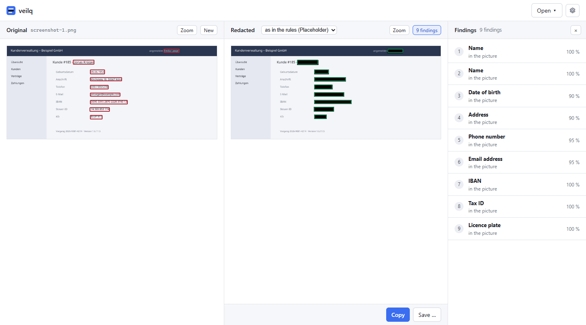

# veilq

Find and redact personal data in text, documents, images and screen
recordings: on your machine, in CI and as an MCP tool for any agent.

> **Status:** 0.2.0. Text, logs, NDJSON, JSON, CSV, Word, Excel,
> PowerPoint, mails, images (PNG, JPEG, WebP), GIF screen recordings and
> PDF are scanned and redacted with German and English patterns, from the
> CLI, a local web UI and an MCP server; pseudonyms can be put back with an
> encrypted mapping. Names that no word marks are found by an optional NER
> model, pictures are read by an optional OCR model, and faces in them
> are filled black by an optional face detector. Handwriting (M5) and
> audio (M6) follow, each with a transcript reviewed before the redaction; see
> [docs/plan.md](docs/plan.md).

## Without a command line

**[Download veilq for Windows](https://github.com/nuetzliches/veilq/releases/latest/download/veilq.exe)**
· [other systems](https://github.com/nuetzliches/veilq/releases/latest)
· [nuetzliches.github.io/veilq](https://nuetzliches.github.io/veilq/)



1. **Double-click `veilq.exe`.** It is not signed yet (#10): Windows asks once.
   Choose "More info", then "Run anyway".
2. **The welcome dialog** puts veilq into your Start menu, for you alone,
   without administrator rights, and downloads what reads pictures (OCR,
   45 MB) and finds names without a title (NER, 600 MB). Text, Office files
   and mails need neither; a picture without OCR offers it where it is
   refused.
3. **Type or paste text, drop a file, or paste a screenshot (Ctrl+V)**; copy
   the redacted result with Ctrl+C or save it. **Open → Redact a folder**
   redacts a whole folder.

Everything runs on your computer: veilq uploads nothing. The UI speaks
German or English, as your system does. Settings → Detection holds your own
rules (your firm's name is no person; a customer number is), Settings →
General looks for a new version when you ask. Uninstall in Settings →
Advanced or under "Installed apps".

## From a command line

```sh
# CI gate: fail when a fixture contains personal data
veilq scan tests/fixtures --sarif > veilq.sarif

# redact a log export as it streams
cat export.ndjson | veilq redact - --format ndjson > export.redacted.ndjson

# redact a screenshot, a screen recording or a scanned PDF before attaching it
veilq redact bug.gif -o bug.redacted.gif

# stand-ins instead of <PERSON>: same type and shape, synthetic
veilq redact letter.txt --action fake

# give an agent the same through MCP
veilq mcp

# put the originals back, with the key the mapping was encrypted to
veilq redact export.csv -o export.redacted.csv --mapping export.map.age
veilq reveal export.redacted.csv --mapping export.map.age --identity key.txt

# set the input beside the redacted output in a local web UI
veilq ui
```

- **German first:** names, addresses, IBAN (checked), tax ID, social security
  number, ID card numbers, licence plates, court file numbers, dates of birth,
  phone numbers. English too.
- **Nothing leaves the machine.** veilq makes no network call with your
  content. Optional models are downloaded once, on request, pinned by
  checksum.
- **Fail closed:** what veilq cannot read is an error, never passed through.
- **Serialisable:** one JSON schema for CLI output and MCP tools
  ([`schema/`](schema)); findings never contain the original value.

## Install

Download the archive for your platform from the
[latest release](https://github.com/nuetzliches/veilq/releases/latest)
(Windows x86_64, Linux x86_64 and arm64, macOS Apple Silicon; there is no
build for Intel Macs, ONNX Runtime publishes none for them),
check it against `SHA256SUMS` and put `veilq` on your `PATH`. Every file has
a build provenance attestation:

```sh
gh attestation verify veilq-x86_64-unknown-linux-gnu.tar.gz --repo nuetzliches/veilq
```

**Signatures** (ADR-0035): a signed release says so in its notes. A signature
says that nuetzliches' release workflow built the file from the tag, the same
as the attestation, in a form Windows and macOS read; it is no review of the
code. To check one: on Windows `Get-AuthenticodeSignature veilq.exe` (status
`Valid`), on macOS `codesign --verify --strict --verbose=2 veilq` and
`spctl --assess --type execute -v veilq`. Until a platform is signed, its
release notes say so and SmartScreen or Gatekeeper ask once.

**Updates** only when you ask: `veilq update` (`--check` only looks), or
Settings → "Check for updates". It installs the newest release where veilq
is, after checking it against the release's `SHA256SUMS`.

**Microsoft Store** (ADR-0039): the release workflow also packs veilq as
MSIX for the Store, which signs it. Installed from there, the Store updates
and removes veilq, `veilq` on the command line and for MCP clients comes
from the package, and its models live in the package's folder.
`pwsh scripts/msix.ps1 -Exe target/release/veilq.exe -Out veilq.msix` packs
one locally (test identity).

Or build it: `cargo install --locked --git https://github.com/nuetzliches/veilq veilq`
(Rust 1.98 or later; the web UI is embedded when `ui/dist` was built first,
`npm ci && npm run build` in `ui/`).

### Optional models

Patterns need nothing else. Three detectors and one reader need files that
veilq does not ship; `veilq models fetch` downloads them from their
publishers, checks them against the SHA-256 compiled into the binary, and
keeps them in the model directory (`veilq models list` shows where;
`VEILQ_MODEL_DIR` moves it):

| Component | What it adds | Source, licence | Size |
|---|---|---|---|
| `ner` | names that no word marks (`Beim Termin war auch Lena Vogt`) | GLiNER `urchade/gliner_multi_pii-v1` in ONNX (onnx-community), Apache-2.0 | 570 MB |
| `ocr` | images, GIF, PDF pages | PaddleOCR PP-OCRv3 detector and PP-OCRv5 Latin recogniser in ONNX (`monkt/paddleocr-onnx`), Apache-2.0 | 10 MB |
| `face` | faces in images, GIF, PDF pages, filled black (found, never recognised) | YuNet 2023mar (OpenCV Zoo, `opencv/face_detection_yunet`), MIT | 0.2 MB |
| `pdf` | PDF (with `ocr`) | PDFium (`bblanchon/pdfium-binaries`), BSD-3-Clause | 7 MB |

`ner`, `ocr` and `face` share ONNX Runtime (Microsoft, MIT, 33 MB), fetched with
the first of them. ONNX Runtime and PDFium are pinned for Windows x86_64,
Linux x86_64 and arm64, and macOS on Apple Silicon.

```sh
veilq models fetch ner
veilq models fetch ocr
veilq models fetch face
veilq models fetch pdf
```

Without a network: `veilq models install <component> --from <dir>` takes
the same files from a directory. A run never downloads anything. Without
OCR an image is an error, and so it is without `face` unless the policy
keeps faces (`[picture] faces = "keep"`); without NER the report says
`review_required`.

The OCR reads printed text. Handwriting, very small or blurred text is read
badly, and personal data in it may be missed: where OCR reads letters or
digits with low confidence and nothing was blacked out there, the report
says `review_required` and where.

## Use

- **`veilq scan <path>`** lists findings (type, place, detector,
  confidence), never the values; `--sarif` for code scanning. Exit code 1
  when something was found, 2 on an error. `--explain` adds, on standard
  error, what veilq read (a picture's OCR lines too) and every candidate
  with its detector, confidence, threshold and verdict: why something was
  found or left. It shows the values; keep it on your own machine.
- **`veilq redact <path>`** writes the redacted input (`-o`, default
  standard output) and, with `--report`, the report as JSON. Actions:
  `mask` (default, `<PERSON>`), `pseudonymize` (`[PERSON:3f2a9c1e]`, keyed),
  `fake` (stand-ins), `remove`; in a picture every action is a black box.
- **Policy:** `veilq.toml` in the current directory or the repository root
  sets locales, actions per type, thresholds, allow lists and own patterns
  ([`schema/policy.schema.json`](schema/policy.schema.json));
  `veilq policy check` validates it.
- **Purposes** (ADR-0040): what veilq is used for, as built-in packs a
  policy names (`purposes = ["legal"]`) or a run takes (`--purpose
  development`). `general` always applies; `legal` lowers the thresholds
  for names, addresses and court file numbers, `development` adds secrets
  (access keys, tokens, private keys, JWTs). A purpose only tightens; the
  policy's own settings come first.
- **Deny lists** (ADR-0044): when the people a text can name are known (a
  member list), `[[deny]]` in the policy finds them always: whole words,
  any case, with the genitive, each part of a full name alone too. The
  values stand inline or in plain text files beside the policy, one per
  line:

  ```toml
  [[deny]]
  files = ["names.txt"]
  ```

  A list of names is personal data itself: keep its files out of the
  repository (`.gitignore`), and a file veilq cannot read stops the run.
- **`veilq mark <body>`** decides on a ticket's description for a gateway
  between a tracker and an agent: a body whose first line is a matching
  `veilq: cleaned|pass <hash>` (or an exempt prefix from the policy's
  `[markers]`) is handed on as it is, any other is redacted as Markdown and
  marked; JSON with `state`, `text` and the `write` to store back
  ([ADR-0024](docs/adr/0024-a-body-carries-its-verdict-in-its-first-line.md)).
- **`veilq ui`** serves a local web UI on loopback, bound to a token, that
  reads files under `--root` only. Started by a double click, veilq opens it
  in an app window, with Settings for setup and models
  ([ADR-0027](docs/adr/0027-a-double-click-opens-the-ui-and-setup-installs-for-the-user.md)).
- **`veilq mcp`** is an MCP server over stdio (or `--http` on loopback with
  a token) with the tools `scan`, `redact_text`, `redact_file` and
  `list_detectors`. In Claude Code:

  ```sh
  claude mcp add veilq -- veilq mcp --root .
  ```

The decisions behind all of this are in [`docs/adr/`](docs/adr).

## Development

`devstack up` runs the web UI against an in-browser mock (`ui`, :4761) and
`veilq ui` with the UI embedded (`veilq`, :4760; the dashboard's link opens it
with its token, `devstack status` lists the URL). Without devstack: `npm ci && npm run dev` in `ui/` for
the mock, `npm run build` there and then `cargo run -- ui` for the real thing.
A build of veilq without `ui/dist` serves a page that says how to get one.

The synthetic corpus in `eval/` gates recall in CI:
`cargo run -p veilq-eval -- check eval` with patterns, and with the models
installed `--ner --ocr --gate eval/gate-ner.toml`. See
[CONTRIBUTING.md](CONTRIBUTING.md).

## Licence

Licensed under either of [Apache License, Version 2.0](LICENSE-APACHE) or
[MIT license](LICENSE-MIT) at your option. The optional models and
libraries keep their own licences (above); veilq does not distribute them.
